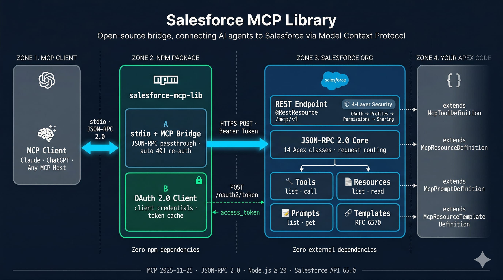

# Salesforce MCP Library

[](https://www.npmjs.com/package/salesforce-mcp-lib)
[](LICENSE)

Open-source bridge connecting AI agents to Salesforce via [Model Context Protocol](https://modelcontextprotocol.io/).



Two packages, zero external dependencies:

| Package | What it does | Install |
|---------|-------------|---------|
| **Apex framework** (2GP unlocked) | MCP server running natively in your Salesforce org (tools, resources, resource templates, prompts, completions) | [source deploy](#1-install-the-apex-framework) or the released 2.0.0.1 package |
| **npm stdio proxy** | OAuth 2.0 lifecycle + stdio-to-HTTPS bridge. Optional when the consumer already handles Salesforce tokens. | `npx salesforce-mcp-lib` |

> **Release status.** The `SalesforceMcpLib` 2.0.0.1 package version is promoted and released
> (`04tdL000000qXzBQAU`, 99% package coverage). The npm 2.0.0 is pending publication: until it is published,
> `npx salesforce-mcp-lib` fetches a 1.x release, so run the proxy from a local build or tarball.
> Test evidence: 188 Apex tests pass (97% org-wide coverage, 99% package coverage), 331 npm tests pass, and a fresh
> install and an upgrade from 1.2.0.1 succeeded in scratch orgs. An upgrade of a real 1.x org is not verified.

---

## Supported protocol versions and compliance

The Apex endpoint serves two protocol eras and decides per request:

| Era | Version | Lifecycle |
|-----|---------|-----------|
| Modern | `2026-07-28` | stateless, `server/discover`, protocol version and client capabilities in every request's `_meta`, routing headers |
| Legacy | `2025-11-25` | `initialize`, `notifications/initialized`, `ping`, `MCP-Protocol-Version` header afterwards |

Older versions (`2025-06-18`, `2025-03-26`, `2024-11-05`) are not advertised. A legacy `initialize` that asks for
one of them gets `2025-11-25` back.

**This library does not claim full MCP compliance.** The 2026-07-28 specification says servers MUST rate limit
tool invocations. A per-tool rate limiter needs storage (SOQL, DML or Platform Cache), which would cost governor
limits on every call, so it is not implemented. The framework relies on Salesforce API request limits and
concurrent request limits. If you need per-tool limits, count calls in your own tool code.

### Feature matrix

Every unsupported feature is absent from the advertised capabilities and answered with `-32601`, so clients are
not misled. Most reasons trace back to one fact: an Apex REST call is one synchronous request, with a CPU limit of
10 s and a heap limit of 6 to 10 MB (see [Governor limits](#governor-limits-and-size-guards)).

| Feature | Modern | Legacy | Why |
|---------|:------:|:------:|-----|
| `server/discover` | yes | no | modern lifecycle |
| `initialize`, `notifications/initialized`, `ping` | no | yes | legacy lifecycle |
| Tools: list, call, `title`, `icons`, `annotations`, `_meta` | yes | yes | |
| Tool `outputSchema` and `structuredContent` | JSON values except top-level null | object only | top-level null means absent; nested nulls are preserved; the legacy projection drops non-object output |
| Content: text, image, audio, resource link, embedded resource, annotations | yes | yes | |
| Resources: list, read, templates list | yes | yes | |
| Resource templates (RFC 6570 level 1) | yes | yes | one variable per `{name}`; no operators, no lists, no multi-segment expansion. A matcher for the full syntax is more CPU per request for little gain |
| Prompts: list, get | yes | yes | |
| Completions (`completion/complete`) | yes | yes | prompt arguments and template variables, at most 100 values |
| Caching fields `ttlMs`, `cacheScope` | yes | not emitted | the legacy schema has none |
| Pagination | yes | yes | opaque cursor, registration order |
| Streamable HTTP, JSON responses | yes | yes | |
| SSE streaming responses | no | no | an Apex REST request cannot hold a stream open |
| `subscriptions/listen`, `resources/subscribe`, list-changed and resource-updated notifications | no | no | needs a long-lived connection and server push |
| MRTR (`input_required`), elicitation, sampling, roots | no | no | need server-to-client input mid-request; a synchronous request cannot wait for it |
| Tasks, progress notifications | no | no | need long-running work or streams; no background state in the framework |
| Logging (`logging/setLevel`, `notifications/message`) | no | no | nothing to stream to; a request-level `logLevel` is accepted and ignored |
| Protocol sessions (`Mcp-Session-Id`, `Last-Event-ID`) | ignored | ignored | stateless by design; no storage on the request path |
| `x-mcp-header` / `Mcp-Param-*` | no | no | registration rejects schemas that contain `x-mcp-header` |
| JSON-RPC batches | no | no | both eras forbid them; arrays get `-32600` |
| Per-tool rate limiting | **no** | **no** | needs storage; see the compliance note above |
| `resources/templates/call` (1.x extension) | removed | removed | not part of MCP; use `resources/read` |
| Protocol versions before 2025-11-25 | no | no | their differences (batching, no `icons`) are not implemented |

### HTTP authentication discovery (JSON-only caveat)

The endpoint is JSON-only and sits behind Salesforce's own gateway. Salesforce, not Apex, rejects a missing or
expired token with its own 401 body. The library publishes no OAuth protected-resource metadata and controls no
`WWW-Authenticate` challenge. An MCP client that expects to discover OAuth endpoints from the MCP server itself
cannot do so here. Give such clients a Bearer token obtained from your External Client App, or use the npm proxy.

---

## How it works

1. **MCP Client** (Claude, ChatGPT, any MCP host) sends JSON-RPC 2.0 messages over **stdio**
2. **npm proxy** authenticates via OAuth 2.0 (client credentials or per-user login), adds the MCP routing headers, forwards each request over HTTPS, and refreshes tokens
3. **Apex MCP Server** dispatches requests to your registered tools, resources, templates, prompts and completions inside Salesforce

Steps 1 and 2 apply when you use the npm proxy. A host that can reach the Apex endpoint over HTTPS with a Bearer
token needs only step 3 (and must send the protocol headers itself, see [architecture](docs/architecture.md)).

The Apex server is stateless. One `McpRuntime` object serves one HTTP request. The framework runs no SOQL, DML or
callouts, keeps no static mutable state and has no session to clean up.

### When you need the proxy (and when you don't)

The Apex `@RestResource` endpoint is the MCP server. The proxy handles OAuth: acquire a token, cache it, refresh
it, re-authenticate once on 401. It also adds the routing headers modern MCP requires.

**Use the proxy** when your MCP host does not manage Salesforce tokens itself (most desktop clients).
**Skip it** when the consumer already has Salesforce OAuth (n8n, cloud agent platforms, your own orchestrator).
Without the proxy, token handling and the protocol headers move into your consumer. Details:
[docs/architecture.md](docs/architecture.md). Exact wire behaviour:
[docs/mcp-wire-contract-2026-07-28.md](docs/mcp-wire-contract-2026-07-28.md).

### Security

| Layer | Enforced by |
|-------|------------|
| OAuth 2.0 scopes | External Client App configuration |
| Profile permissions | Salesforce platform, **only if your code runs in user mode** |
| Permission Sets | Salesforce platform, same condition |
| Sharing rules | Salesforce platform, `with sharing` classes only |

The first layer is automatic. The next three apply to your tool, resource and prompt code only when you write it
that way. See [Developer responsibilities](#developer-responsibilities).

## Why External Client Apps

The library supports the OAuth 2.0 `client_credentials` flow and the authorization code flow with PKCE, and does not
care which Salesforce app container issued the credentials. This documentation standardizes on **External Client Apps
(ECA)** so setup guidance stays ahead of the platform direction.

---

## Quick start

### 1. Install the Apex framework

**Source install (available now).** From a checkout of this repository, with the Salesforce CLI authenticated to a
sandbox or scratch org:

```bash
sf project deploy start --source-dir force-app --target-org YOUR_ORG --wait 10
```

Deploying to production requires you to run tests (`--test-level RunLocalTests`). The framework has no namespace,
so your classes reference `McpServer`, `McpTool` and the rest directly.

**Package install.** Version 2.0.0.1 is released, so production accepts it. Production URL:
`https://login.salesforce.com/packaging/installPackage.apexp?p0=04tdL000000qXzBQAU`
(sandbox: replace `login` with `test`). Or with the CLI:

```bash
sf package install --package 04tdL000000qXzBQAU --target-org <org> --wait 20 --publish-wait 10
```

The other `04t` ids in `sfdx-project.json` are 1.x versions.

### 2. Create your MCP endpoint (two Apex classes)

The endpoint is a `@RestResource` class. The framework API is `public`, the endpoint itself is `global` because Apex REST
entry points require it:

```apex
@RestResource(urlMapping='/mcp/minimal')
global with sharing class MinimalMcpEndpoint {
    @HttpPost
    global static void post() {
        new McpServer('minimal-example', '1.0.0')
            .tool(new MinimalTool())
            .handle(RestContext.request, RestContext.response);
    }
}
```

A tool extends `McpTool`, describes its input with `McpSchema`, and implements `execute`:

```apex
public with sharing class MinimalTool extends McpTool {
    public MinimalTool() {
        super('echo');
        title('Echo')
            .description('Echoes the provided message back to the caller')
            .input(McpSchema.obj()
                .requiredProperty('message', McpSchema.str().describe('The message to echo').minLength(1).maxLength(1000))
                .closed())
            .annotations(new McpToolAnnotations().readOnly(true).openWorld(false));
    }

    public override McpToolResult execute(McpRequest request) {
        return McpToolResult.text(request.requireString('message'));
    }
}
```

Registration errors (a bad tool name, a duplicate URI, a schema that is too large) throw `McpConfigurationException`
when the endpoint runs, so a broken endpoint fails on its first request and in your tests, not silently.

### 3. Configure an External Client App

**Option A, client credentials** (service account, no user interaction): create an External Client App with the
**OAuth 2.0 Client Credentials** flow. Note the `client_id` and `client_secret`.

**Option B, per-user auth** (individual identity, recommended): create an External Client App with
**Authorization Code + PKCE**. Callback URL: `http://localhost:13338/oauth/callback`. Scopes: `api`, `refresh_token`.
See the [Per-User Auth Setup Guide](specs/003-per-user-auth/quickstart.md) for the steps.

### 4. Connect an AI agent

**Per-user auth** (recommended for Claude Code). Log in once in a terminal:

```bash
npx salesforce-mcp-lib login \
  --instance-url https://your-org.my.salesforce.com \
  --client-id YOUR_CLIENT_ID
```

Then add the server to Claude Code through `/mcp`, or edit `~/.claude.json`:

```json
{
  "mcpServers": {
    "salesforce": {
      "command": "npx",
      "args": [
        "-y", "salesforce-mcp-lib",
        "--instance-url", "https://your-org.my.salesforce.com",
        "--client-id", "YOUR_CLIENT_ID",
        "--endpoint", "/services/apexrest/mcp/minimal"
      ]
    }
  }
}
```

**Client credentials** (service account): add `"--client-secret", "YOUR_CLIENT_SECRET"` to `args`.

The auth mode is detected from the config: `--client-secret` present means client credentials, absent means per-user.
Until 2.0.0 is published on npm, run the proxy from a checkout: `cd packages/salesforce-mcp-lib && npm ci && npm run build`,
then use `node /path/to/packages/salesforce-mcp-lib/dist/index.js` instead of `npx -y salesforce-mcp-lib`.

---

## Apex API walkthrough

All classes below are `public`, in the `force-app/main/mcp/classes` directory. Fluent setters return the receiver.
Complete, deployable code lives in [`examples/`](examples/).

### Server

```apex
new McpServer('acme-sales', '1.0.0')
    .title('Acme sales')
    .instructions('Call query_accounts first, then read one account through salesforce://account/{id}.')
    .tool(new ExampleQueryTool())
    .resource(new ExampleOrgResource())
    .resourceTemplate(new ExampleAccountTemplate())
    .prompt(new ExampleSummarizePrompt())
    .allowOrigin('https://app.example.com')   // browser clients only; no Origin header is always allowed
    .listCache(60000, McpServer.CACHE_PRIVATE) // ttlMs and scope for list results (default 0, private)
    .pageSize(50)                              // 1 to 100
    .maxRequestBytes(262144)                   // 1,024 to 6,000,000
    .maxResponseBytes(262144)
    .handle(RestContext.request, RestContext.response);
```

Tool, prompt and resource registration order is the listing order. `skipOutputValidation()` exists, see
[Tools](#tools).

### Tools

From [`ExampleQueryTool`](examples/e2e-http-endpoint/force-app/main/default/classes/ExampleQueryTool.cls):

```apex
public with sharing class ExampleQueryTool extends McpTool {
    public ExampleQueryTool() {
        super('query_accounts');
        title('Query accounts')
            .description('Search for Account records by name')
            .input(McpSchema.obj()
                .requiredProperty('searchTerm', McpSchema.str().describe('Account name search term').minLength(2).maxLength(80))
                .property('limit', McpSchema.integer().minimum(1).maximum(50))
                .closed())
            .output(McpSchema.obj()
                .requiredProperty('accounts', McpSchema.arr(McpSchema.obj()
                    .requiredProperty('id', McpSchema.str())
                    .requiredProperty('name', McpSchema.str())
                    .property('industry', McpSchema.str().nullable()))))
            .annotations(new McpToolAnnotations().readOnly(true).openWorld(false));
    }

    public override McpToolResult execute(McpRequest request) {
        String escaped = request.requireString('searchTerm').replace('\\', '\\\\').replace('%', '\\%').replace('_', '\\_');
        String pattern = '%' + escaped + '%';
        Integer max = request.getInteger('limit') == null ? 10 : request.getInteger('limit');
        List<Object> rows = new List<Object>();
        for (Account a : [SELECT Id, Name, Industry FROM Account WHERE Name LIKE :pattern WITH USER_MODE ORDER BY Name LIMIT :max]) {
            rows.add(new Map<String, Object>{ 'id' => a.Id, 'name' => a.Name, 'industry' => a.Industry });
        }
        return McpToolResult.structured(new Map<String, Object>{ 'accounts' => rows });
    }
}
```

Result helpers: `McpToolResult.text(String)`, `.structured(Object)`, `.error(String)`, and the chain `add(McpContent)`,
`structuredContent(Object)`, `markError()`, `meta(key, value)`. Typed getters on `McpRequest`: `getString`,
`requireString`, `getInteger`, `getLong`, `getDecimal`, `getBoolean`, `getMap`, `getList`. A wrong type throws
`McpException`, which the framework turns into a tool result with `isError: true`.

- A tool with a builder `output(...)` schema must return `structuredContent` on success. A mismatch is a server bug
  and returns `-32603`. `skipOutputValidation()` on the server turns both checks off.
- `McpToolResult.structured(...)` also adds a JSON text copy for clients that ignore `structuredContent`. That copy
  doubles the counted response size, see [size guards](#governor-limits-and-size-guards).
- A tool without `input(...)` advertises `{"type":"object","additionalProperties":false}` and rejects any argument
  with a tool error.
- Result values must be JSON-native: `null`, `String`, `Boolean`, `Integer`, `Long`, `Decimal`, `Double`, `Date`,
  `Datetime`, `Time`, `Id`, `Blob`, `Map<String, X>`, `List<X>` and `SObject` (populated fields). Precision and
  nested `null` values are kept. A top-level `structured(null)` or `structuredContent(null)` means no structured content.
  Compound `Address` and `Location` fields are supported. A `Set`, a `Map` with a non-`String` key (`Map<Id, X>`), an enum or a custom Apex
  object is refused with `-32603` "Internal error" before it is serialized, and the debug log says what to convert.
  Use `new List<String>(set)`, a `Map<String, X>` keyed by `String.valueOf(id)`, or a `Map<String, Object>`.
- Names: 1 to 128 characters from `A-Z a-z 0-9 _ . -`, unique per kind.

### Resources and resource templates

```apex
public with sharing class ExampleOrgResource extends McpResource {
    public ExampleOrgResource() {
        super('salesforce://org/info', 'org_info');
        title('Org information').mimeType('application/json');
    }

    public override McpResourceResult read(McpRequest request) {
        Organization org = [SELECT Name, OrganizationType, IsSandbox FROM Organization WITH USER_MODE LIMIT 1];
        return McpResourceResult.of(McpResourceContents.text(getUri(), 'application/json', JSON.serialize(org)))
            .cache(60000, McpServer.CACHE_PRIVATE);
    }
}

public with sharing class ExampleAccountTemplate extends McpResourceTemplate {
    public ExampleAccountTemplate() {
        super('salesforce://account/{id}', 'account');
        title('Account').mimeType('application/json');
    }

    public override McpResourceResult read(McpRequest request) {
        Id recordId;
        try { recordId = Id.valueOf(request.variable('id')); } catch (Exception e) { return null; } // null = not found
        List<Account> rows = [SELECT Id, Name, Industry FROM Account WHERE Id = :recordId WITH USER_MODE LIMIT 1];
        if (rows.isEmpty()) { return null; }
        return McpResourceResult.of(McpResourceContents.text(request.uri(), 'application/json', JSON.serialize(rows[0])));
    }
}
```

`resources/read` checks static URIs first, then templates in registration order, and the first match wins. Binary
content uses `McpResourceContents.blob(uri, mimeType, Blob)` or `blobBase64(...)`. Not found is `-32602` in the
modern era and `-32002` in the legacy era (the framework picks the code).

**Template limitation (RFC 6570 level 1 only).** A template may contain only `{name}` expressions with names from
`A-Za-z0-9_`. Operators (`{+x}`, `{#x}`, `{.x}`, `{/x}`, `{;x}`, `{?x}`, `{&x}`), explode and prefix modifiers, and
two adjacent expressions are rejected at registration. A variable matches one or more characters except
`/ ? # &`, and the value is percent-decoded before you read it with `request.variable(name)`. Invalid percent
encoding means no match.

### Prompts

```apex
public with sharing class ExampleSummarizePrompt extends McpPrompt {
    public ExampleSummarizePrompt() {
        super('summarize_record');
        title('Summarize record')
            .argument('objectName', 'API name of the object', true)
            .argument('recordId', 'The record ID to summarize', true);
    }

    public override McpPromptResult get(McpRequest request) {
        String objName = request.promptArguments().get('objectName');
        String recordId = request.promptArguments().get('recordId');
        return new McpPromptResult()
            .description('Summarize ' + objName + ' record')
            .user(McpContent.text('Please summarize the ' + objName + ' record with ID ' + recordId + '.'));
    }
}
```

Prompt arguments are strings. `assistant(McpContent)` adds an assistant message. A missing required argument is
`-32602`.

### Completions

Override `complete` on a prompt or a resource template. The framework calls it for `completion/complete` after it
has checked that the argument name is declared:

```apex
public override McpCompletion complete(String argumentName, String value, Map<String, String> context) {
    if (argumentName == 'objectName') {
        return McpCompletion.of(new List<String>{ 'Account', 'Contact', 'Opportunity' });
    }
    return McpCompletion.none();
}
```

More than 100 values are cut to 100 with `hasMore: true` and `total` set to the original count (the shape the spec
defines). `McpCompletion.of(values).total(n).hasMore(true)` sets them explicitly.

### Rich content

`McpContent` builds the content blocks of tool results and prompt messages. Every block takes optional
`annotations(McpAnnotations)` and `meta(key, value)`:

```apex
return new McpToolResult()
    .add(McpContent.text('Report attached.'))
    .add(McpContent.imageBase64(pngBase64, 'image/png'))
    .add(McpContent.resourceLink('salesforce://account/' + accountId, 'account').title('The account').mimeType('application/json'))
    .add(McpContent.embedded(McpResourceContents.text('salesforce://report/1', 'text/csv', csv))
        .annotations(new McpAnnotations().audience(new List<String>{ 'user' }).priority(0.8)));
```

`image` and `audio` also have `Blob` overloads, `imageBase64` and `audioBase64` take an already encoded string.
`title`, `description`, `mimeType`, `size` and `icon` apply to resource links only. Icons use `new McpIcon('https://...')`
(`https:` or `data:` sources only).

### Schema subset and validation

`McpSchema` builders emit JSON Schema and validate tool arguments before `validate()` and `execute()` run. The
validated subset is exactly:

| Keyword | Builder |
|---------|---------|
| `type`: string, integer, number, boolean, object, array, plus `null` | `str()`, `integer()`, `num()`, `bool()`, `obj()`, `arr(items)`, `.nullable()` |
| `properties`, `required` | `property(name, schema)`, `requiredProperty(name, schema)` |
| `additionalProperties: false` | `closed()` |
| `enum` (strings only) | `enumOf(List<String>)` |
| `minLength`, `maxLength` | on `str()`, counted in UTF-16 code units |
| `minimum`, `maximum` | on `integer()`, `num()` |
| `minItems`, `maxItems`, `items` (one schema) | on `arr()` |

`title`, `describe` (description), `defaultValue` and `format` are emitted but **not validated**. `pattern`,
`oneOf`/`anyOf`/`allOf`, `if/then/else`, `$ref`, and numeric `enum` values are not offered by the builder. Validation
stops after 10 errors and returns them in one `isError` result.

`inputSchema(Map)` and `outputSchema(Map)` accept a raw schema. The framework checks only the registration limits
(root `type` is `object` for input, depth 16, 1,000 nodes in total, 200 entries per collection, no `x-mcp-header`,
`$ref` only to `#...`, no cycles) and that `arguments` is an object. **A raw schema is trusted: the framework does not
validate arguments against it. Override `validate(McpRequest)` and check everything yourself.** Raw output schemas
are never checked against the result.

### Developer responsibilities

The framework cannot enforce these for you:

- **Security mode.** The framework classes are `inherited sharing`, but your handlers decide what runs. Use
  `with sharing` classes and `WITH USER_MODE` (or `Security.stripInaccessible`) so CRUD, field-level security and
  sharing apply to the calling user. A `without sharing` or system-mode query returns data the user may not see.
- **Raw schema validation.** See above. A raw `inputSchema` validates nothing by itself.
- **Side effects and errors.** DML and callouts that a tool performed stay committed when the response is later
  refused as too large or fails output validation. The framework adds no savepoint, because a savepoint counts against
  the DML limit. Bound your own output, and design write tools to be safe to retry.
- **Error text.** Only the message of an `McpException` is shown to the client. Any other exception becomes
  `-32603` "Internal error", and its type, message and stack go to the debug log. Do not put secrets or record data in
  `McpException` messages.
- **Limits in your code.** The framework guards do not stop your SOQL, DML or loops from hitting a governor limit.
  A `LimitException` cannot be caught, so the caller gets a Salesforce platform error body instead of a JSON-RPC
  envelope (the npm proxy turns that into a local error).
- **Rate limiting.** There is none per tool, see [compliance](#supported-protocol-versions-and-compliance).

### Governor limits and size guards

- Default request and response limit: **262,144 bytes (256 KiB)** each way. Raise them with `maxRequestBytes` and
  `maxResponseBytes`, within 1,024 to 6,000,000 (the platform limit for Apex REST).
- The runtime also reads `Limits.getLimitHeapSize()` and `Limits.getHeapSize()` at request time and never assumes a
  heap size. The effective request limit is `min(maxRequestBytes, remaining heap / 8)`, the effective response limit is
  `min(maxResponseBytes, remaining heap / 3)`. Synchronous heap is 6 MB, or 10 MB where Winter '27 is active
  ([release note](https://help.salesforce.com/s/articleView?id=release-notes.rn_apex_heap_limit.htm&release=264.0.0&type=5)).
- Before serializing, the framework walks the whole result map and estimates its JSON size. After serializing, it
  measures the real bytes. Over the limit is `-32603` "Response exceeds the server size limit". Nothing is truncated.
- `McpToolResult.structured(...)` returns the data twice, as `structuredContent` and as a JSON text block. The budget
  counts both, so a structured result over about half the response limit is refused by design. Raise
  `maxResponseBytes` for such tools.
- The `/8` and `/3` factors are **heuristics, not guarantees**. An `SObject` is sized by its populated fields plus a
  fixed 128 bytes. Text that JSON escapes heavily (quotes, control characters) serializes larger than the estimate and
  is caught only after serialization, when the heap is already spent. Parsing a 256 KiB request can use several
  seconds of the 10 s CPU limit on its own.
- Request bodies nested more than 32 levels deep are refused before the parser runs (`-32600` "Request structure too
  large"). The check costs about 2 ms normally and at most about 1 s at 256 KiB.
- A list page is one response. There is no adaptive paging, so call `pageSize(n)` with a smaller `n` when the items
  (descriptions, schemas) are large, otherwise the page is the size error.

---

## Migrating from 1.x

2.0.0 is a breaking release. The generic JSON-RPC layer (`force-app/main/json-rpc`, 14 classes) and the 1.x MCP classes
were removed and replaced by the classes below. `McpServer` kept its name with a new API.

| 1.x | 2.0.0 |
|-----|-------|
| `new McpServer()` + `registerTool(t)` | `new McpServer(name, version)` + `.tool(t)` |
| `registerResource(r)`, `registerPrompt(p)` | `.resource(r)`, `.prompt(p)`, new `.resourceTemplate(t)` |
| `server.handleRequest(req, res)` | `server.handle(req, res)` |
| `McpToolDefinition` (fields `name`, `description`, `inputSchema()`, `validate(Map)`, `execute(Map)`) | `McpTool`: `super(name)`, `title/description/input(McpSchema)`, `execute(McpRequest)` |
| `McpResourceDefinition` (`read()`) | `McpResource` (`super(uri, name)`, `read(McpRequest)`) |
| `McpResourceTemplateDefinition` (`read(arguments)`) | `McpResourceTemplate` (`super(uriTemplate, name)`, `read(McpRequest)`, `request.variable(name)`) |
| `McpPromptDefinition` (`get(Map<String,String>)`) | `McpPrompt` (`argument(...)`, `get(McpRequest)`) |
| `McpPromptArgumentDefinition`, `McpPromptMessage` | `McpPrompt.argument(...)`, `McpPromptResult.user/assistant(McpContent)` |
| `McpTextContent`, `McpResourceContentItem` | `McpContent`, `McpResourceContents` |
| `McpToolResult` with a public `content` list | `McpToolResult.text/structured/error` and `add(McpContent)` |
| `McpInvalidParamsException` | `McpException` (tool: `isError` result; prompt, resource, completion: `-32602`) |
| `McpToolAnnotations` fields | `McpToolAnnotations` fluent setters |
| `resources/templates/call` | removed, use `resources/read` |
| JSON-RPC batch requests | rejected with `-32600` |
| `JsonRpc*` and `McpJsonRpc*` classes, handler classes | removed, no replacement (internals are `McpRuntime`, `McpWire`) |

Behaviour changes to check in your code:

- Tool arguments are validated against the builder schema before `validate()` runs. Raw `inputSchema(Map)` is not.
- Registration errors throw `McpConfigurationException` (tool and prompt names must match `[A-Za-z0-9_.-]{1,128}`).
- Results larger than the size limit fail with `-32603` instead of being returned.
- Handler errors: `McpException` text is shown to the client, other exceptions are hidden as "Internal error".
- A client must send the protocol version. A request without `MCP-Protocol-Version` (and without `_meta` version) gets
  HTTP 400 with `-32020`, except `initialize` that names no version, and notifications.
- A tool without `input(...)` rejects any argument. Result values must be JSON-native: return a `List` instead of a
  `Set`, string keys instead of `Id` keys, and a `Map<String, Object>` instead of a custom object.
- With the npm proxy, upgrade the proxy to 2.0.0 at the same time as the Apex package. The proxy adds the headers.

### Upgrading an org that has 1.x installed

The package is unlocked and keeps its package id. 2.0.0 deletes classes that 1.x subscriber code may reference,
and reuses the name `McpServer` with an incompatible API. **Existing 1.x endpoint classes will not compile against
2.0.0, and this repository has not proven that an install over 1.x succeeds or that any existing endpoint survives
the class removals in your org.** A scratch-org test with no 1.x endpoint classes installed 1.2.0.1, then the 2.0.0.1
package, without error. Plan accordingly:

1. Migrate and deploy in a **sandbox** first, against a scratch org or sandbox copy that has 1.x installed.
2. Rewrite your endpoint, tool, resource and prompt classes for the 2.0.0 API in source control.
3. Install the new package version with `--upgrade-type Mixed` (the default) and `--apex-compile package`, then
   deploy your migrated classes in the same maintenance window. See the
   [Salesforce guide](https://developer.salesforce.com/docs/atlas.en-us.sfdx_dev.meta/sfdx_dev/sfdx_dev_unlocked_pkg_install_pkg_upgrade.htm)
   for how removed components are handled.
4. If the install fails or blocks on references from your classes, stop and fix the cause in the sandbox. Do not assume
   the platform will rewrite or remove references for you.

The upgrade test covered only the package itself, with no subscriber classes that reference 1.x. Subscriber
references are still untested.

---

## CLI reference

### MCP server mode

```
salesforce-mcp-lib [options]
```

| Option | Env variable | Required | Description |
|--------|-------------|----------|-------------|
| `--instance-url` | `SF_INSTANCE_URL` | Yes | Salesforce org URL. https only; plain http is accepted for `localhost`, `[::1]` and `127.x.x.x` (tests) |
| `--client-id` | `SF_CLIENT_ID` | Yes | External Client App consumer key |
| `--client-secret` | `SF_CLIENT_SECRET` | No* | External Client App consumer secret |
| `--endpoint` | `SF_ENDPOINT` | Yes | Apex REST path, starting with a single `/` |
| `--callback-port` | `SF_CALLBACK_PORT` | No | Local OAuth callback port (default `13338`) |
| `--log-level` | `SF_LOG_LEVEL` | No | `debug` / `info` / `warn` / `error` (default `info`) |
| `--request-timeout-ms` | `SF_REQUEST_TIMEOUT_MS` | No | Deadline per forwarded request, covering authentication, retry and response (1000 to 600000, default `120000`) |
| `--max-concurrency` | `SF_MAX_CONCURRENCY` | No | Concurrent requests to Salesforce (1 to 25, default `4`) |

\* With `--client-secret`: client credentials flow. Without: per-user auth (needs a prior `login`).

### Login subcommand (per-user auth)

```
salesforce-mcp-lib login [options]
```

| Option | Env variable | Required | Description |
|--------|-------------|----------|-------------|
| `--instance-url` | `SF_INSTANCE_URL` | Yes | Salesforce org URL (same https rule) |
| `--client-id` | `SF_CLIENT_ID` | Yes | External Client App consumer key |
| `--headless` | `SF_HEADLESS` | No | Print the auth URL instead of opening a browser |
| `--callback-port` | `SF_CALLBACK_PORT` | No | Local OAuth callback port (default `13338`) |
| `--log-level` | `SF_LOG_LEVEL` | No | Log level (default `info`) |

### Proxy behaviour and limits

- Requests run with the concurrency limit above. 64 requests may wait; a full queue gets a local `-32603`. Queued plus
  in-flight input is capped at 64 MiB of line bytes in total. One input line may be 6 MiB at most.
- A response body over 8 MiB is aborted with a local error.
- `notifications/cancelled` is handled in the proxy: it removes a queued request or aborts an in-flight one and drops
  its response. Work Apex already started still completes. Other notifications are forwarded and never answered.
  Progress and other server-to-client notifications do not exist (see the matrix).
- Remote JSON-RPC bodies are passed through with only inter-token whitespace removed, so large integers and decimals
  keep their exact spelling.
- OAuth calls have their own 30 s total deadline, separate from `--request-timeout-ms`.
- Failures that are not a JSON-RPC answer (Salesforce error array, HTML, network error) become a local `-32603` error
  with `data.source = "salesforce-mcp-lib-proxy"`. Tokens, secrets and remote bodies never reach logs or errors.

### HTTP statuses (direct clients)

| Status | When |
|--------|------|
| 200 | success, and handler-level errors (tool `isError`, `-32602`, `-32603`) |
| 202 | notification, empty body |
| 400 | parse error, invalid request, missing or wrong protocol header, unsupported version (`-32022`), missing `_meta` field |
| 403 | `Origin` not allowed |
| 404 | unknown method in the modern era (`-32601`) |
| 405 | not `POST` (`Allow: POST`) |
| 413 | request body over the limit |

Legacy-era unknown methods answer 200 with `-32601`. Full tables: [wire contract](docs/mcp-wire-contract-2026-07-28.md).

---

## Tech stack

- **Apex**: API 65.0, no external dependencies, no SOQL, DML or callouts inside the framework
- **TypeScript**: ES2022, Node.js >= 20, zero npm production dependencies
- **Protocol**: MCP `2026-07-28` and `2025-11-25` over JSON-only Streamable HTTP and stdio
- **Packaging**: Salesforce 2GP unlocked package (no namespace), npm package `salesforce-mcp-lib`

## Project structure

```
force-app/main/
  mcp/classes/         # MCP server framework (public API, McpRuntime/McpWire internals, tests)
packages/salesforce-mcp-lib/
  src/                 # TypeScript stdio proxy (protocol.ts, mcpBridge.ts, stdio.ts, auth modules)
  tests/               # Unit tests
examples/
  minimal/             # Single-tool echo example
  e2e-http-endpoint/   # Tool, resource, template and prompt
dev/mcp-harness/       # Development-only endpoint for the MCP Inspector
docs/                  # Architecture, wire contract, design notes
scripts/               # Scratch org, test and release scripts
```

## Contributing

CI (`.github/workflows/ci.yml`) runs the npm package on Node 20 and 22: `npm ci`, `npm test`, `npm run lint`,
`npm run build`. It needs no secrets and does **not** run Apex.

Validate Apex changes yourself in a scratch org before you submit. You need a Dev Hub you are logged in to:

```bash
./scripts/org-create.sh my-scratch --target-dev-hub YOUR_DEV_HUB   # or set SF_DEVHUB
./scripts/org-test.sh                                              # RunLocalTests with coverage
```

`org-create.sh` creates the scratch org, sets it as default and deploys `force-app`. Every class with executable lines
should keep at least 90% coverage. To run the examples, deploy them as well:

```bash
sf project deploy start --source-dir examples/minimal/force-app --source-dir examples/e2e-http-endpoint/force-app
```

Then run the TypeScript suite:

```bash
cd packages/salesforce-mcp-lib && npm ci && npm test && npm run lint
```

Releases create the package version from the Dev Hub that owns the package, with `scripts/release-create.sh
--target-dev-hub <hub>` (or `SF_DEVHUB`). Validation and code coverage are never skipped.

## License

[MIT](LICENSE)
